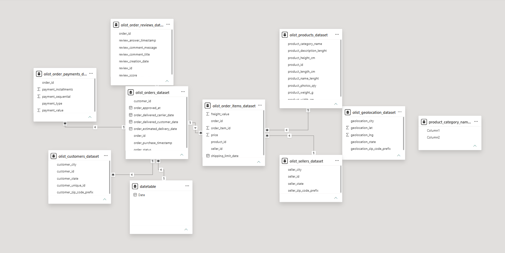

# Olist Brazilian E-Commerce Analysis \| Power BI Portfolio Project

**Author:** Ademola Melody\
**Tools:** Power BI · Power Query · DAX\
**Project type:** End-to-end business intelligence and data analysis

> This project explores historical Brazilian e-commerce data from Olist
> to understand sales performance, customers, products, sellers,
> delivery operations, and customer experience. It demonstrates a
> workflow from data preparation and data modelling to DAX measures,
> interactive dashboards, and business recommendations.

------------------------------------------------------------------------

## Table of Contents

-   [Project Overview](#project-overview)
-   [Business Questions](#business-questions)
-   [Dashboard Preview](#dashboard-preview)
-   [Tools and Technologies](#tools-and-technologies)
-   [Dataset and Tables](#dataset-and-tables)
-   [Data Cleaning and
    Transformation](#data-cleaning-and-transformation)
-   [Data Model](#data-model)
-   [DAX Measures and KPI
    Definitions](#dax-measures-and-kpi-definitions)
-   [Dashboard Walkthrough](#dashboard-walkthrough)
-   [Key Findings](#key-findings)
-   [Business Recommendations](#business-recommendations)
-   [Limitations and Interpretation
    Notes](#limitations-and-interpretation-notes)
-   [Access the Power BI Report](#access-the-power-bi-report)
-   [What I Practised](#what-i-practised)
-   [Author](#author)

------------------------------------------------------------------------

## Project Overview

The objective of this project was to turn Olist's historical e-commerce
data into an interactive report that helps users explore commercial
performance and operational outcomes.

Using Power BI, I prepared and transformed data in Power Query,
connected the datasets in a relational model, created DAX measures, and
built a six-page report.

The analysis focuses on:

-   Sales and revenue trends
-   Order and customer activity
-   Product-category and seller performance
-   Freight and delivery performance
-   Cancellations and customer reviews
-   Customer distribution across Brazilian states

## Business Questions

The report was designed to investigate questions such as:

1.  How do sales and revenue change over time?
2.  Which product categories contribute most to sales and revenue?
3.  How are sales distributed across sellers?
4.  What are the order and customer totals?
5.  What is the average order value?
6.  How long do deliveries take, and how often are orders late?
7.  What proportion of orders are cancelled?
8.  How are customer review scores distributed?
9.  Which Brazilian states account for the most customers?
10. How do customer and order activity vary by state and month?

## Dashboard Preview

The Power BI report contains six pages. Select a screenshot to view the
image in the repository.

### 1. Executive Overview

### 2. Sales & Customers

### 3. Operation & Customer Experience

### 4. Product & Seller Performance

### 5. Geographic Customer Analysis

### 6. Executive Summary

## Tools and Technologies

  ---------------------------------------------------------------------
  Tool                               How it was used
  ---------------------------------- ----------------------------------
  Microsoft Power BI                 Data modelling, report design,
                                     interactive visuals, and KPI
                                     presentation

  Power Query                        Data cleaning, transformation, and
                                     preparation

  DAX (Data Analysis Expressions)    Measures and performance
                                     indicators

  Relational data modelling          Connecting the datasets for
                                     analysis

  Data visualisation                 KPI cards, line charts, bar
                                     charts, donut charts, and other
                                     report visuals
  ---------------------------------------------------------------------

## Dataset and Tables

The project uses the **Olist Brazilian E-Commerce Public Dataset**, a
historical dataset covering e-commerce activity from 2016 to 2018.

The model uses these ten tables:

  ------------------------------------------------------------------------
  Table                                 Purpose in the analysis
  ------------------------------------- ----------------------------------
  `olist_orders_dataset`                Order dates, order status, and
                                        delivery-related timestamps

  `olist_order_items_dataset`           Products and sellers associated
                                        with orders, item prices, and
                                        freight

  `olist_customers_dataset`             Customer identifiers and customer
                                        location

  `olist_products_dataset`              Product attributes and
                                        product-category information

  `olist_sellers_dataset`               Seller identifiers and seller
                                        location

  `olist_order_payments_dataset`        Payment methods and payment values

  `olist_order_reviews_dataset`         Customer review scores and
                                        review-related information

  `olist_geolocation_dataset`           Geographic coordinates and
                                        location data

  `product_category_name_translation`   English translations of
                                        product-category names

  `datetable`                           A custom date table spanning
                                        January 2016 through December 2018
                                        for time-based analysis
  ------------------------------------------------------------------------

The source data is historical, so the findings describe the period
covered by the dataset rather than the current e-commerce market.

## Data Cleaning and Transformation

I used Power Query to prepare the source tables before building the
report. The work included reviewing data types and column consistency,
standardising customer city names, investigating repeated geolocation
records, examining unusual or placeholder review values, and checking
date and timestamp columns.

The screenshots below document the before-and-after preparation work for
the tables where I captured evidence.

### Customers

  -----------------------------------------------------------------------------------------------
  Before cleaning                                  After cleaning
  ------------------------------------------------ ----------------------------------------------
     cleaning](Screenshots/customers_cleaned.png)

  -----------------------------------------------------------------------------------------------

### Geolocation

  ---------------------------------------------------------------------------------------------------
  Before cleaning                                    After cleaning
  -------------------------------------------------- ------------------------------------------------
     cleaning](Screenshots/geolocation_cleaned.png)

  ---------------------------------------------------------------------------------------------------

### Order Items

  -------------------------------------------------------------------------------------------------
  Before cleaning                                   After cleaning
  ------------------------------------------------- -----------------------------------------------
     cleaning](Screenshots/order_item_cleaned.png)

  -------------------------------------------------------------------------------------------------

### Order Payments

  -------------------------------------------------------------------------------------------------------
  Before cleaning                                       After cleaning
  ----------------------------------------------------- -------------------------------------------------
     cleaning](Screenshots/order_payments_clean.png)

  -------------------------------------------------------------------------------------------------------

### Order Reviews

  -------------------------------------------------------------------------------------------------------
  Before cleaning                                      After cleaning
  ---------------------------------------------------- --------------------------------------------------
     cleaning](Screenshots/order_reviews_cleaned.png)

  -------------------------------------------------------------------------------------------------------

### Product Category Translation

  -------------------------------------------------------------------------------------------------------------------------------------------
  Before cleaning                                                        After cleaning
  ---------------------------------------------------------------------- --------------------------------------------------------------------
     cleaning](Screenshots/product_category_name_translation_clean.png)

  -------------------------------------------------------------------------------------------------------------------------------------------

### Products

  ---------------------------------------------------------------------------------------------
  Before cleaning                                 After cleaning
  ----------------------------------------------- ---------------------------------------------
     cleaning](Screenshots/products_cleaned.png)

  ---------------------------------------------------------------------------------------------

### Sellers

  -----------------------------------------------------------------------------------------
  Before cleaning                                After cleaning
  ---------------------------------------------- ------------------------------------------
     cleaning](Screenshots/sellers_clean.png)

  -----------------------------------------------------------------------------------------

These images are evidence of the preparation steps captured for this
portfolio. They should not be interpreted as a claim that every possible
data-quality issue in the source dataset has been eliminated.

## Data Model

I connected the tables to support analysis across orders, customers,
products, sellers, payments, reviews, geography, and dates. The
relationships allow report visuals and measures to analyse data through
the relevant fields and dimensions.

The model view is included as evidence of the relationships used in the
report. The exact relationship cardinalities and filter directions
should be assessed from the model itself; this README does not assume
that every table forms a textbook star schema.

## DAX Measures and KPI Definitions

I created DAX measures to summarise performance and support the report's
KPIs and time-based analysis. Measures reported in the project include:

  ---------------------------------------------------------------------
  Measure                            Purpose
  ---------------------------------- ----------------------------------
  `Total Sales`                      Sum of order-item prices

  `Total Revenue`                    Order-item prices plus freight

  `Total Orders`                     Counts orders according to the
                                     measure's order-counting logic

  `Total Customers`                  Counts customers according to the
                                     measure's customer-counting logic

  `Total Products`                   Summarises the products
                                     represented in the model

  `Total Sellers`                    Summarises the sellers represented
                                     in the model

  `Total Freight`                    Sum of freight values

  `Average Order Value`              Average order value under the
                                     report's measure definition

  `Average Delivery Days`            Average delivery duration under
                                     the report's delivery-date logic

  `Late Delivery Rate`               Share of orders classified as late
                                     under the measure's logic

  `Cancellation Rate`                Share of orders classified as
                                     cancelled under the measure's
                                     logic

  `Average Review Score`             Average customer review score

  `Orders per Customer`              Order activity relative to the
                                     customer base

  `Previous Month Revenue`           Revenue for the previous month,
                                     subject to date context

  `Previous Year Revenue`            Revenue for the comparable
                                     prior-year period, subject to date
                                     context

  `Revenue Growth %`                 Revenue change expressed as a
                                     percentage under the measure's
                                     comparison logic

  `YTD`                              Year-to-date calculation using the
                                     date context
  ---------------------------------------------------------------------

Additional measures may exist in the Power BI file. The table above
lists measures identified for this project; it is not a claim that these
are the only measures in the model.

**Metric note:** DAX results depend on the exact formula, relationship
paths, filter context, and treatment of missing dates or statuses. The
definitions above describe intended use and should not be treated as a
substitute for inspecting the actual DAX expressions in the `.pbix`
file.

## Dashboard Walkthrough

### 1. Executive Overview

This page provides a high-level snapshot of business activity, including
KPI cards for Total Sales, Orders, Customers, and Average Order Value.
It also compares sales over time, product-category performance, and
order status.

Reported headline values displayed on this page include:

-   Total Sales: approximately **13.59M**
-   Orders: approximately **99K**
-   Customers: approximately **96K**
-   Average Order Value: approximately **136.68**

These values are reproduced from the project dashboard and have not been
independently recalculated from the source data in this README.

### 2. Sales & Customers

This page explores sales trends by month, top product categories, and
payment-method distribution. Credit card payments are the most prominent
payment type in the reported visual, followed by boleto and voucher.

### 3. Operation & Customer Experience

This page focuses on delivery and post-purchase experience. It includes
average delivery days, late-delivery rate, cancellation rate, review
scores, delivery status, and monthly trends.

Reported KPI values include:

-   Average Delivery Days: approximately **3.2**
-   Late Delivery Rate: approximately **8%**
-   Cancellation Rate: approximately **1%**
-   Average Review Score: approximately **4**

These values should be interpreted using the definitions and filters
implemented in the report.

### 4. Product & Seller Performance

This page compares product and seller activity, category revenue,
product counts by category, seller sales, and freight.

Reported headline values include:

-   Products: approximately **33K**
-   Sellers: approximately **3,095**
-   Total Sales: approximately **13.59M**
-   Total Freight: approximately **2.25M**

The seller-level visual can help identify large contributors, while
category comparisons can highlight areas for further investigation.

### 5. Geographic Customer Analysis

This page examines customer distribution by Brazilian state and orders
per customer by state. São Paulo (SP) leads in customer volume in the
reported dashboard.

Higher orders-per-customer values in states with smaller customer
populations should be interpreted cautiously: a high ratio may be driven
by a relatively small number of customers.

### 6. Executive Summary

This page consolidates key indicators and monthly sales, revenue, and
order trends. The reported visuals show stronger sales/revenue activity
around May and June and a decline in order activity around September and
October. These patterns are descriptive of the dataset period and merit
further investigation before being used for forecasting.

## Key Findings

Based on the report visuals and project notes:

1.  **Sales are concentrated in selected categories.** Beauty & Health
    (`beleza_saude`) appears among the leading categories in the
    reported sales visual.
2.  **Customer activity is geographically concentrated.** São Paulo is
    the leading state by customer count in the dashboard.
3.  **Delivery performance deserves attention.** The report tracks late
    deliveries and monthly changes in delivery time, helping identify
    periods for operational investigation.
4.  **Five-star reviews are the most common score in the reported
    distribution.** Lower ratings still warrant investigation to
    understand recurring customer pain points.
5.  **Seller and category performance vary.** Comparing these dimensions
    can help prioritise deeper analysis of high- and low-performing
    areas.
6.  **Monthly activity is not uniform.** The report shows variation in
    sales, revenue, and order counts across months.

These are descriptive findings from the dashboard, not proof of causal
relationships. The exact interpretation depends on the report's filters
and measure definitions.

## Business Recommendations

### 1. Investigate late deliveries

Compare late-order patterns by month, seller, customer state, and
delivery duration. Identify recurring bottlenecks before deciding which
operational changes to prioritise.

### 2. Monitor seller performance

Review sales alongside fulfilment and delivery indicators, rather than
evaluating sellers on sales volume alone.

### 3. Investigate category-level opportunities

Track leading categories while examining the causes of weaker
performance in other categories. Validate trends over time before making
inventory or marketing decisions.

### 4. Explore geographic opportunities carefully

Use customer counts and order activity together. States with high
orders-per-customer ratios but small customer bases should be assessed
with sample size in mind.

### 5. Connect reviews to operational indicators

Compare review scores with delivery outcomes and order status to
identify patterns worth investigating. Correlation alone does not
establish that delivery performance caused a review score.

### 6. Track KPIs consistently

Document measure definitions and maintain consistent date and status
filters so stakeholders can compare performance across periods reliably.

## Limitations and Interpretation Notes

-   The dataset covers historical transactions from **2016--2018** and
    does not represent the current market.
-   The analysis is limited to the fields and quality of the source
    dataset.
-   Seller and customer identifiers do not provide full business context
    on their own.
-   Relationships between delivery performance and reviews are
    descriptive; they do not establish causation.
-   KPI values depend on the underlying DAX formulas, relationship
    configuration, and report filters.
-   Some screenshots were captured for selected tables; the absence of a
    screenshot does not mean a table was excluded from the model.
-   Findings should be validated against the source data and business
    context before being used for operational decisions.

## Access the Power BI Report

The `.pbix` file is too large to store directly in this GitHub
repository. It will be hosted externally so reviewers can download the
full interactive Power BI report.

**Download the Power BI report (.pbix):**
`[Add your Google Drive or OneDrive sharing link here]`

> Before publishing, replace the placeholder above with the actual share
> link and test it in a private/incognito browser window to confirm that
> reviewers can access the file without requesting permission.

## What I Practised

This project gave me practical experience with:

-   Preparing and transforming data in Power Query
-   Reviewing data quality and consistency
-   Connecting multiple datasets in a Power BI data model
-   Writing DAX measures for business KPIs and time-based analysis
-   Designing a multi-page interactive report
-   Analysing sales, customers, products, sellers, geography, and
    delivery
-   Turning visual findings into practical recommendations
-   Documenting an analytical workflow for a portfolio

## Author

**Ademola Melody**\
Data Analytics Portfolio Project
